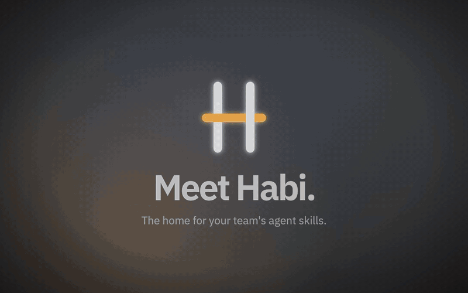
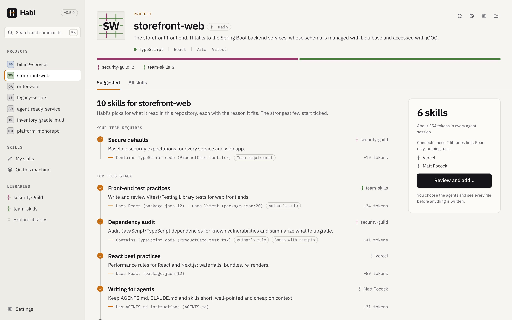
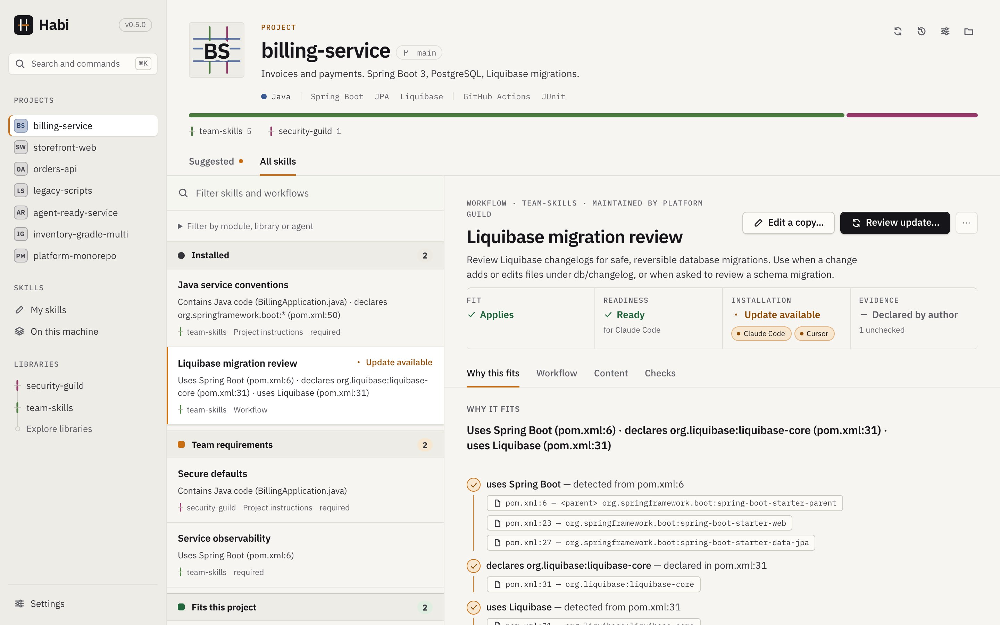
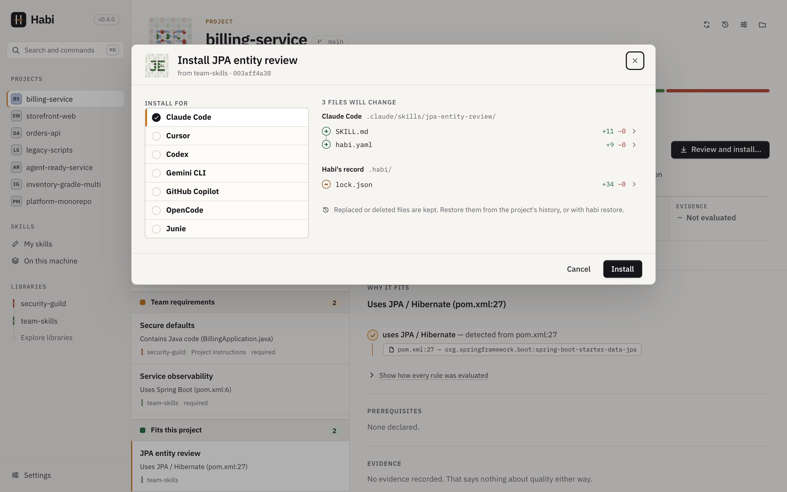
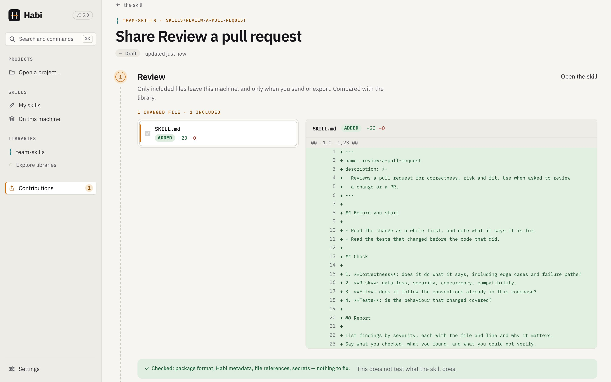

<div align="center">

# Habi

**Find what applies. Improve what works. Share what you learn.**

Habi is a local desktop app for the skills and instructions you give AI coding agents.<br>Open a repository and Habi shows which skills fit it, and why, down to the file and line.

<a href="https://github.com/acltabontabon/habi/releases/latest"></a> <a href="https://github.com/acltabontabon/habi/actions/workflows/ci.yml"></a>  <a href="LICENSE"></a>

<a href="https://github.com/acltabontabon/habi/releases/latest"><b>Download</b></a> &nbsp;·&nbsp; <a href="https://acltabontabon.com/habi/docs/">Documentation</a> &nbsp;·&nbsp; <a href="https://acltabontabon.com/habi/">Website</a>

<a href="https://acltabontabon.com/habi/#demo"></a>

</div>

## What it does

- **Find** skills that fit your repo, each with the files and lines behind it. Nothing is built or run.
- **Install** them for your agents, after previewing every file.
- **Edit** a copy locally: the full package with instructions, scripts, references and assets.
- **Share** improvements back to a library as a pull or merge request, after seeing exactly what leaves your machine.
- **Update** what you installed, in a project or on your machine, after seeing exactly what changed.
- **Trust** what you see: every skill shows its author, license and origin. No account, telemetry, cloud service or model call.

Skills are ordinary [Agent Skills](https://agentskills.io) folders and shared instructions go
into `AGENTS.md`, so everything keeps working without Habi. Git uses your existing credentials.

## Supported agents

Habi writes to the folders each agent already reads, and installs as few copies as it can.

| Agent | Skills | Instructions | MCP servers |
|---|---|---|---|
| Claude Code | `.claude/skills/` | `CLAUDE.md`, importing `AGENTS.md` | `.mcp.json` |
| Cursor | `.agents/skills/` or `.claude/skills/` | `AGENTS.md` | `.cursor/mcp.json` |
| Codex | `.agents/skills/` | `AGENTS.md` | `.codex/config.toml` |
| Gemini CLI | `.agents/skills/` | `GEMINI.md`, importing `AGENTS.md` | `.gemini/settings.json` |
| GitHub Copilot | `.agents/skills/` or `.claude/skills/` | `AGENTS.md` | `.mcp.json` |
| OpenCode | `.agents/skills/` or `.claude/skills/` | `AGENTS.md` | `opencode.json` |
| Junie | `.agents/skills/` | `AGENTS.md` | `.junie/mcp/mcp.json` |

Skills can also go in the same folders under your home folder, for all your projects. See
[Agent tools](docs/guide/agent-tools.md) for the details and what isn't supported.

## Supported technology

Habi reads these from a repository's manifests and files, without running anything, and matches
skills to them. [Detectors](docs/library-authors/detectors.md) has every rule.

| Area | Recognized |
|---|---|
| Languages | Java, Kotlin, TypeScript, JavaScript, Python, Go, Rust, C#, PHP, Scala, shell, HCL |
| Build and packages | Maven, Gradle, npm, pnpm, Go modules, Cargo, pip, Poetry, uv, Pipenv, Composer |
| Java and Kotlin | Spring Boot, Spring, Spring Security, Spring Batch, Spring Cloud, Quarkus, Micronaut, GraalVM |
| JavaScript and TypeScript | React, Vue, Angular, Next.js, Svelte, Vite, Express, NestJS |
| Go | Gin, Echo, Fiber, Wails |
| Rust | Axum, Actix, Tauri, Tokio |
| Python | Django, Flask, FastAPI |
| PHP | Laravel, Symfony |
| Databases and APIs | Liquibase, Flyway, jOOQ, JPA, GORM, Diesel, SQLx, SQLAlchemy, Doctrine, OpenAPI, springdoc |
| Data | dbt, Airflow, Dagster, Prefect, Spark, Beam, Kafka, Great Expectations, pandas, Polars, DuckDB, Databricks, Delta Lake, MLflow, Jupyter |
| Infrastructure and CI | Docker, GitHub Actions, GitLab CI, Terraform, Terragrunt, Helm, Kubernetes, Kustomize, Ansible, Pulumi |
| Testing | JUnit, Testcontainers, Jest, Vitest, Playwright, Cypress, pytest, PHPUnit, Bats, Gauge, Robot Framework, Cucumber, Selenium, TestNG, Spock, Mockito, REST Assured, Karate, Gatling, JMeter, k6, Locust, Karma, Jasmine, Mocha, WebdriverIO, Appium, Pact, WireMock, Postman |

## Install

<p align="center">
<a href="https://github.com/acltabontabon/habi/releases/latest"></a>
&nbsp;
<a href="https://github.com/acltabontabon/habi/releases/latest"></a>
<br>
<sub>macOS 11 or later, Apple Silicon and Intel &nbsp;·&nbsp; Windows 64-bit</sub>
</p>

Or on macOS, with Homebrew:

```sh
brew install --cask acltabontabon/tap/habi
```

The first launch asks you to confirm once, because the installers are not signed by Apple or
Microsoft ([how](docs/guide/getting-started.md#installing)). Updates after that are signed with
Habi's own key.

## A look inside

<table>
<tr>
<td width="50%" valign="top"><br><b>Suggested, for every project</b><br><sub>A short list for this repository, each with its reason and what it costs in context.</sub></td>
<td width="50%" valign="top"><br><b>Fits, and why</b><br><sub>Every skill matched to the repository, with the files and lines behind it.</sub></td>
</tr>
<tr>
<td width="50%" valign="top"><br><b>See every file first</b><br><sub>Nothing is written until you say so.</sub></td>
<td width="50%" valign="top"><br><b>Send it back</b><br><sub>Preview what leaves your machine, then open a pull request.</sub></td>
</tr>
</table>
