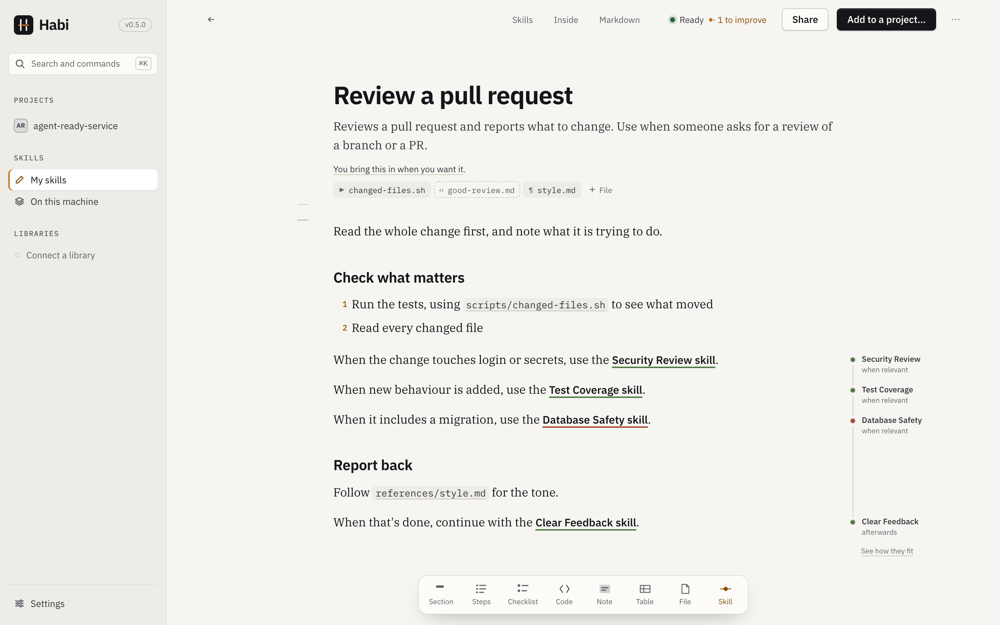

# Habi

**Find what applies. Improve what works. Share what you learn.**

Habi is a local desktop app for the skills and instructions you give AI coding agents. Open a repository and Habi shows which skills fit it, and why, down to the file and line.

  

<a href="https://acltabontabon.com/habi/docs/">Documentation</a> &nbsp;·&nbsp; <a href="https://acltabontabon.com/habi/">Website</a>

## What it does

- **Find** skills that fit your repo, with the files and lines behind each one.
- **Install** them for your agents, after previewing every file.
- **Improve** your own copy, and update it when the library changes.
- **Share** your fixes back as a pull or merge request.

No account, telemetry, cloud service or model call, and nothing in your repo is run. Skills are
ordinary files, so they keep working without Habi.

## Install

| Platform | Requires | Get it |
|---|---|---|
|  **macOS** | 11 or later, Apple Silicon or Intel | [Download](https://github.com/acltabontabon/habi/releases/latest) or `brew install --cask acltabontabon/tap/habi` |
|  **Windows** | 64-bit | [Download](https://github.com/acltabontabon/habi/releases/latest) |

<b>First launch</b> &nbsp;you confirm once

The installers are not signed by Apple or Microsoft, so your system asks once.

- **macOS:** choose **Open Anyway** in System Settings → Privacy & Security.
- **Windows:** choose **More info**, then **Run anyway**.

Updates after that are signed with Habi's own key.

## Supported

<b>Agents</b> &nbsp;Claude Code, Cursor, Codex, Gemini CLI, GitHub Copilot, OpenCode, Junie

| Agent | Skills | Instructions | MCP servers |
|---|---|---|---|
| **Claude Code** | `.claude/skills/` | `CLAUDE.md`, importing `AGENTS.md` | `.mcp.json` |
| **Cursor** | `.agents/skills/` or `.claude/skills/` | `AGENTS.md` | `.cursor/mcp.json` |
| **Codex** | `.agents/skills/` | `AGENTS.md` | `.codex/config.toml` |
| **Gemini CLI** | `.agents/skills/` | `GEMINI.md`, importing `AGENTS.md` | `.gemini/settings.json` |
| **GitHub Copilot** | `.agents/skills/` or `.claude/skills/` | `AGENTS.md` | `.mcp.json` |
| **OpenCode** | `.agents/skills/` or `.claude/skills/` | `AGENTS.md` | `opencode.json` |
| **Junie** | `.agents/skills/` | `AGENTS.md` | `.junie/mcp/mcp.json` |

<b>Languages and frameworks</b> &nbsp;Java, Kotlin, TypeScript, JavaScript, Python, Go, Rust, PHP, C#, Scala, shell, HCL

| Language | Frameworks | Build | Data access |
|---|---|---|---|
| **Java, Kotlin** | Spring Boot, Spring, Spring Security, Spring Batch, Spring Cloud, Quarkus, Micronaut, GraalVM | Maven, Gradle | JPA, jOOQ |
| **TypeScript, JavaScript** | React, Vue, Angular, Next.js, Svelte, Vite, Express, NestJS | npm, pnpm | |
| **Python** | Django, Flask, FastAPI | pip, Poetry, uv, Pipenv | SQLAlchemy |
| **Go** | Gin, Echo, Fiber, Wails | Go modules | GORM |
| **Rust** | Axum, Actix, Tauri, Tokio | Cargo | Diesel, SQLx |
| **PHP** | Laravel, Symfony | Composer | Doctrine |

<b>Infrastructure</b> &nbsp;containers, cloud, CI, migrations, APIs

| Area | Tools |
|---|---|
| **Containers** | Docker, Kubernetes, Helm, Kustomize |
| **Cloud** | Terraform, Terragrunt, Pulumi, Ansible |
| **CI** | GitHub Actions, GitLab CI |
| **Database migrations** | Liquibase, Flyway |
| **APIs** | OpenAPI, springdoc |

<b>Data</b> &nbsp;pipelines, analysis

| Area | Tools |
|---|---|
| **Pipelines** | dbt, Airflow, Dagster, Prefect, Spark, Beam, Kafka, Great Expectations |
| **Analysis** | pandas, Polars, DuckDB, Databricks, Delta Lake, MLflow, Jupyter |

<b>Testing</b> &nbsp;unit, browser, API, acceptance, performance

| Area | Tools |
|---|---|
| **Unit and integration** | JUnit, TestNG, Spock, Mockito, Testcontainers, Jest, Vitest, Mocha, Jasmine, Karma, pytest, PHPUnit, Bats |
| **Browser and mobile** | Playwright, Cypress, Selenium, WebdriverIO, Appium |
| **API** | REST Assured, Karate, Pact, WireMock, Postman |
| **Acceptance** | Cucumber, Gauge, Robot Framework |
| **Performance** | Gatling, JMeter, k6, Locust |

## A look inside

<table>
<tr>
<td width="50%" valign="top"> <b>Suggested, for every project</b></td>
<td width="50%" valign="top"> <b>Fits, and why</b></td>
</tr>
<tr>
<td width="50%" valign="top"> <b>Libraries for your projects</b></td>
<td width="50%" valign="top"> <b>Seven agents, every file shown first</b></td>
</tr>
<tr>
<td width="50%" valign="top"> <b>Write a skill as one document</b></td>
<td width="50%" valign="top"> <b>Send it back as a pull request</b></td>
</tr>
</table>
