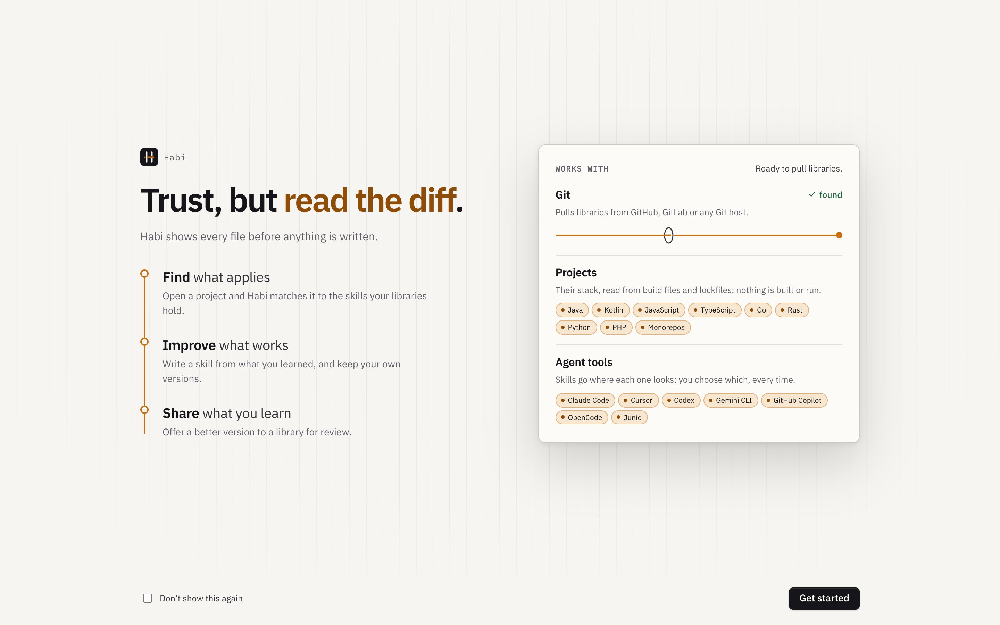
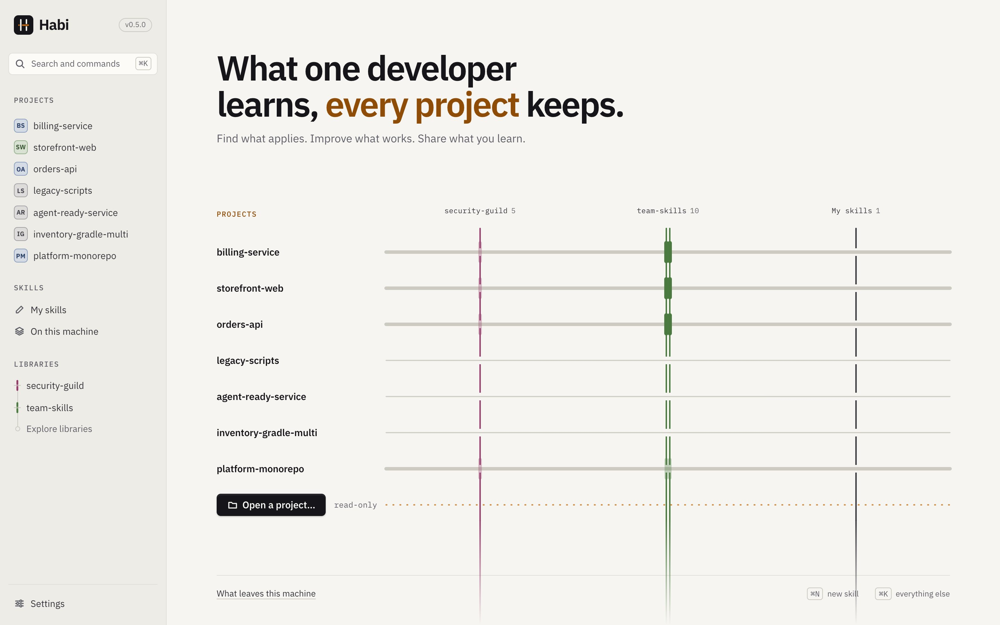
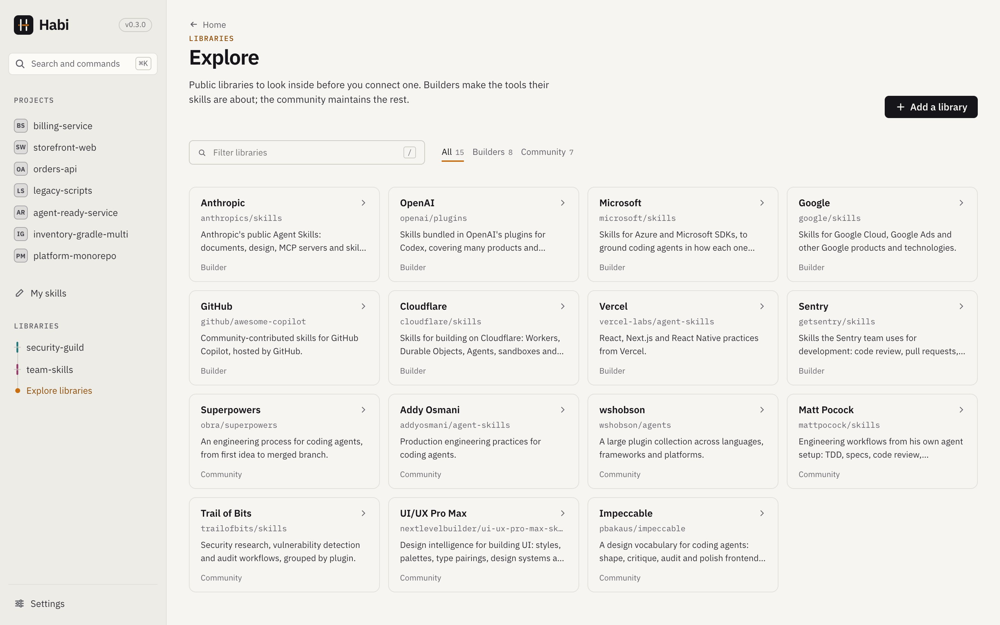
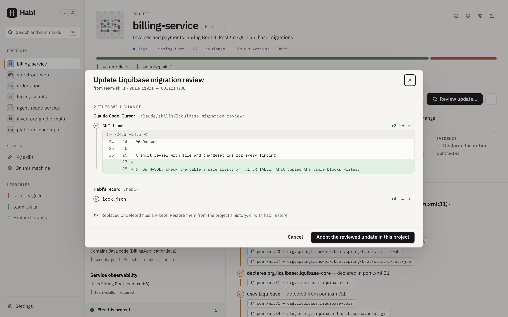
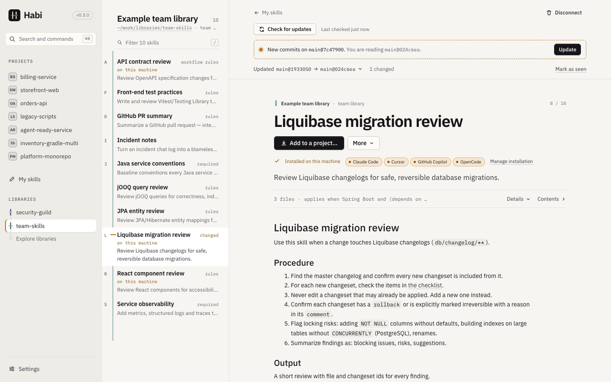
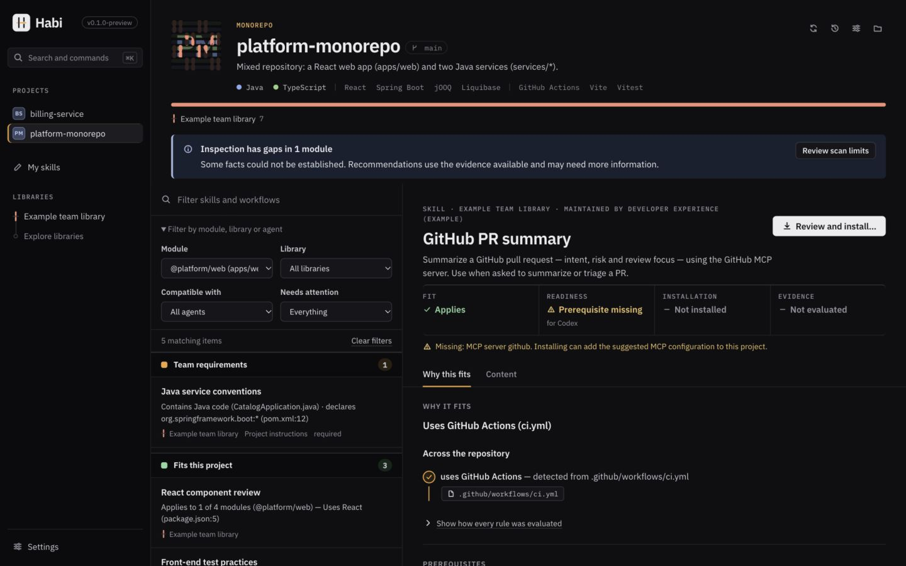

# Getting started

Habi shows which skills fit your repository, installs them for your agent tools, and carries
improvements back to the library. It runs on macOS 11 or later, and on Windows, 64-bit (it
needs WebView2, which Windows 10 and 11 include).

## Installing

Download the installer for your system from the
[Releases page](https://github.com/acltabontabon/habi/releases): the `universal.dmg` for macOS
(Apple Silicon and Intel), or the `.msi` or `-setup.exe` for Windows.

On macOS you can also install with [Homebrew](https://brew.sh):

```sh
brew install --cask acltabontabon/tap/habi
```

Homebrew does not get around the check below, so the first launch still asks you to confirm.
Habi updates itself after that; `brew upgrade` is not needed.

The installers are not signed by Apple or Microsoft, so the first launch asks you to confirm:

- **macOS:** open Habi once. When macOS says it cannot check it, go to **System Settings →
  Privacy & Security** and choose **Open Anyway** next to Habi. On macOS 11 and 12 it is
  **System Preferences → Security & Privacy → Open Anyway**. (Or, in Terminal:
  `xattr -dr com.apple.quarantine /Applications/Habi.app`.)
- **Windows:** when SmartScreen says *Windows protected your PC*, choose **More info**, then
  **Run anyway**.

You confirm once. Updates after that are signed with Habi's own key, and checked before they
install. To build Habi yourself instead, see [CONTRIBUTING](../../CONTRIBUTING.md#set-up).

## The welcome

The welcome screen checks your setup. It requires Git (for pulling libraries) and optionally
detects GitHub/GitLab CLI for opening pull and merge requests. Disable it anytime in
Settings → This machine → Welcome. Its **What leaves this machine** link, like **Privacy and
security** in the command palette, opens the page that lists everything Habi sends and what it
never does.



## The home page

The home page shows your projects as rows, with library skills woven across them: solid lines
show installed skills, faded lines show skills that fit but aren't installed yet.



## Where libraries come from

**Libraries** lists every library you have connected, one line each: your team's Git
repositories and folders, and the public libraries you picked. Those that need you (an update
waiting, offline, a failed fetch) come first. **Add a library** connects a Git repository, a
folder, or one from the catalog.

**Explore** is the catalog: public libraries from the builders of the tools and from the
community, filtered by either. Opening one shows what is inside before you connect it.
Connecting fetches a copy; Habi tells you when something newer exists and updates it only when
you say so.



## Your first project

1. **Open a project** and pick a repository. Habi reads build files and structure (no execution).

2. **Start from what Habi suggests.** A new project opens on **Suggested**: a short list of
   skills for it, before you connect anything. Each says why it fits (*Uses React ·
   package.json:4*) and whose word that is: the author's rule, a team requirement, *Habi's pick*,
   or *From its description* when Habi read the skill's own words. A skill your other projects
   already use comes first (*Also in …*). The strongest few start ticked, since every skill costs
   a little context in every agent session; rows say about how much, and whether a skill comes with
   scripts. Tick what else you want, then **Review and add…**. Libraries the picks come from are
   connected first (read only, nothing runs).

3. **All skills** lists everything your connected libraries hold for the project, grouped by how
   well it fits, with the full reasoning down to the file and line. Missing info (e.g.,
   dependencies inherited from outside the repo) can be answered by you. Connect more from
   **Libraries**: a Git repository, a folder, or a public library from the catalog. If you use
   Claude Code here, an installed skill also says whether it gets used (*Used 12× in Claude Code
   here in 30 days*, *Not used in Claude Code here in 30 days*), so you can remove what you no longer
   need: [what Habi reads for that](../project/security-model.md#claude-code-session-history).

4. **Install:** Review preselected agent tools, check the files that will change, and confirm.
   You see every file before anything is written.

5. **Keep it current.** When a library publishes something newer, the project says *Update
   available*. **Review update…** shows what changed, file by file, before anything is written,
   and keeps your own edits. Skills installed on your machine update the same way, from
   [Skills → On this machine](my-skills.md#on-this-machine).



Next: [My skills](my-skills.md) (write and edit skills) or [Sharing](sharing.md) (send improvements back).

### Check a library for updates

Open a connected library and choose **Check for updates** above the skill reader. You can
check again at any time, even if Habi checked recently. The button shows progress, then says
whether an update is available or the library is up to date. If the check fails, the cached
skills stay readable and you can try again.

When an update is available, **Update** fetches the library's latest contents and shows what
changed. Installed skills are updated separately through their reviewed plans. For a folder
library, **Refresh library** reads its current contents directly.

The library also marks skills **on this machine**. Open one to see the agent tools that
can read it, then choose **Manage installation** to reach its controls in
[Skills → On this machine](my-skills.md#on-this-machine).



### Focus the recommendations

Below the search field, **Filter by module, library or agent** opens filters for a module,
library, compatible agent, and items needing attention (updates, missing prerequisites,
unanswered questions, or failed/outdated checks). A module filter keeps skills whose rules
hold or remain unknown there, plus skills without rules. The agent filter checks declared
compatibility and the readers of existing skill folders; it does not prove the agent loaded
anything. Habi remembers these choices separately for each project. **Clear filters** brings
the full list back.

If inspection has gaps, a notice above the list opens **Review scan limits**. It explains
which modules and detectors were incomplete, rather than treating missing evidence as absence.

In an item's **Prerequisites**, **Readiness for** shows the chosen agent's own configuration.
An MCP entry for Cursor does not establish readiness for Codex. Install review checks the
agents selected there too. An entry is only *Configured*: Habi does not start or authorize
the server, and it does not read user-level MCP settings.



## Checks and corrections

A skill can declare **checks**: commands that confirm it works in your project. They are on
the skill's **Checks** tab. Habi shows the exact program, arguments, folder and time limit
first, and lists anything in the command that stands out. The command runs only when you
press **Run this command**. It runs your repository's code on your machine and is not
sandboxed.

The evidence summary counts the latest completed result for each declared check in each
applicable module. **Partially checked** means some pairs are still unchecked, or inspection
was incomplete. A failure remains visible even if a different check passed later; cancelling
a run preserves the previous completed result. An old failure, like an old pass, is marked
out of date when the item or inspected project state changes.

Habi notices ordinary source and script edits through file sizes and modification times,
without reading their bodies. Changes outside inspection's scope (ignored files, environment
variables, external services, or edits preserving size and modification time) are not covered.
A passing result establishes only that command's success condition.

When the files can't say whether a skill fits, the **Why this fits** tab asks, for example
*Does api use jOOQ?*, and you answer **Yes** or **No**, with a note if you like. The answer
stays on your machine, is labelled *You declared this present* (or *absent*) wherever the
evidence is shown, and is listed under Project settings → Your corrections. **Undo** removes it,
and recommendations go back to what Habi found.

## Keeping Habi current

**Settings → Updates** sets how often Habi checks your connected libraries for something newer
(Manual, 6 h, 12 h or Daily) and whether it looks for a newer Habi on its own (**Check for new
releases**, Automatic or Manual). The version at the top of the sidebar opens the About page:
**What's new** lists the release notes, **Check for updates** looks now, and **Update and
restart** installs a newer Habi after checking its signature. Nothing is installed until you
press it.

## Shortcuts

**⌘K** opens the command palette (*Search and commands* in the sidebar), which reaches every
project, library and action. **⌘N** starts a new skill, **⌘O** opens a project, **⌘,** opens
Settings and **⌘[** goes back. Shortcuts shown as ⌘ are Ctrl on Windows.

## What Habi writes

In your project (only after you confirm):
- Skill folders in `.claude/skills/` or `.agents/skills/`
- A managed section in `AGENTS.md` with import line in `CLAUDE.md` or `GEMINI.md`
- MCP server entries (optional)
- `.habi/lock.json` to track installations

On your machine:
- Skill folders in `~/.claude/skills/` or `~/.agents/skills/`
- `~/.habi/lock.json`

See [Agent tools](agent-tools.md) for exact file locations. Every change is journaled and can be restored via [Recovery](recovery.md).

## What Habi never does

- Runs builds, package managers, scripts or Git to inspect your repo
- Changes your checkout or branches
- Sends anything about you or your projects unless you share it
- Uses accounts, telemetry or cloud services

The few requests Habi makes on its own (the update check, the library check and the catalog's
public repository figures) are listed on the Privacy and security page.

**Removing Habi:** The app can be uninstalled safely—installed skills and `.habi/lock.json` remain as ordinary files.
