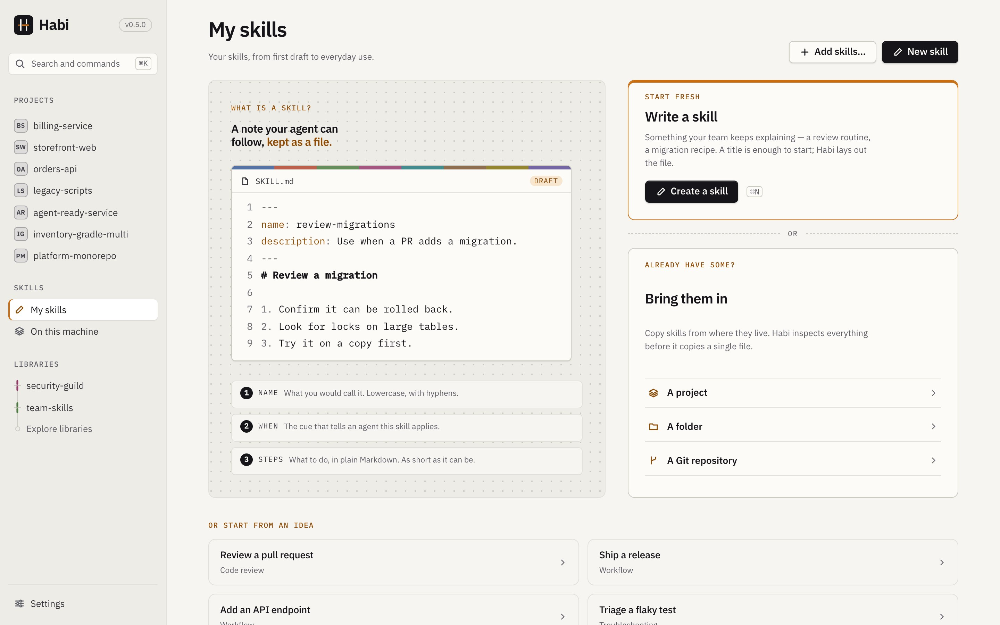
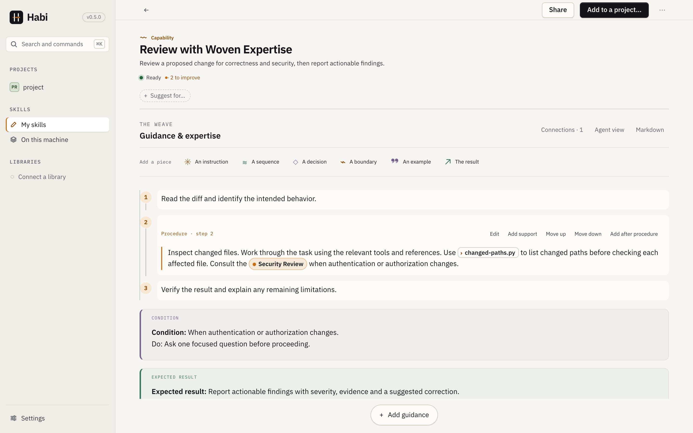
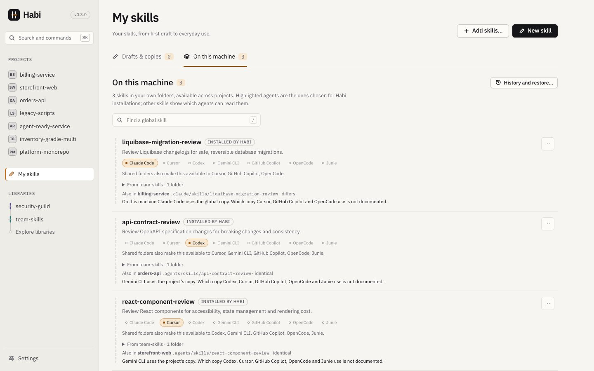
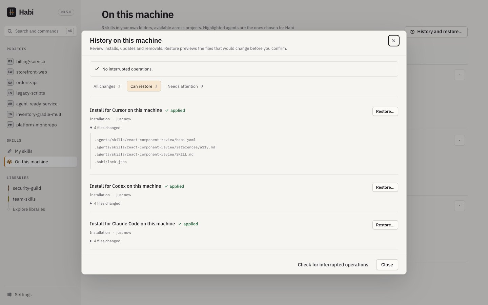

# My skills

Write your own skills, edit others', test them against projects—all offline, no account or
model needed. When ready, use in a project or on your machine. Share when it's worth sharing.

## What is where, and who owns it

| Thing | Where it lives | What Habi does with it |
|---|---|---|
| A skill **in a project** (`.claude/skills/…`, `.agents/skills/…`, any folder with `SKILL.md`) | The project, untouched | Lists it under *Already here* and lets you read it, copy it or turn part of it into a skill. |
| An **instruction file** (`AGENTS.md`, `CLAUDE.md`, `GEMINI.md`, Cursor and Claude rules, Copilot instructions) | The project, untouched | Lists it with its sections. You can copy a part into a draft; the file is never rewritten by this. |
| A skill **on this machine** (`~/.claude/skills`, `~/.agents/skills` and each tool's own folder) | Your home folder | Lists it under *On this machine*. Habi changes only the skills it installed there. |
| A skill in **My skills** (a draft, or a copy) | `<data>/skills/<id>/package/`, a plain Agent Skills folder | Yours to edit. Not installed or shared until you choose. |
| A skill in a **library** | Habi's read-only copy of the library | Never edited in place. *Edit a copy…* makes an attributed copy in My skills; your edits go back through a reviewed contribution. |
| An **installed copy** | The project, or your home folder | Written only through a reviewed plan. Editing your skill afterwards does not change it; the change shows as an update. |

`<data>` is Habi's data folder; Settings → This machine → Data folder shows where it is.

## Creating a skill

The sidebar's **Skills** section has two pages: **My skills** for editable skills you keep
in Habi, and **On this machine** for global skills in your agent folders. A count next to
either one shows how many of its skills have a newer version in their library.

Before you have written one, My skills explains what a skill is, and offers a title,
an idea or skills you already have.

**New skill** opens a visual palette of guidance pieces. Habi auto-names it from your content: the first heading
becomes the title, and the title becomes the identifier (until you change it or install).
*Use the opening line* sets the purpose from your opening sentence.

## The Skill Studio

Start with the skill's identity: its name and the purpose an agent reads before choosing it.
The weave below holds the guidance, procedures, conditions and results. Its structure follows
ordinary instructions, not a guaranteed execution graph. A standalone skill is complete without
any links to other skills.

Choose **An instruction**, **A sequence**, **A decision**, **A boundary**, **An example**, or
**The result**. The illustrated pieces show the shape of the guidance before you choose. One click
places an editable example on the canvas and selects the first words for you to replace. A sequence
starts with three editable steps; a decision starts with When/Do guidance. No creation form is needed.
The smaller palette remains above your work as it grows. The **Weave in** strip connects a
**Skill**, **Script**, or **Reference** to the selected instruction through the same contextual
workflow. **Use existing material** reuses a file already in the package.

Select a piece to reveal **Edit**, **Add support**, **Move up**, **Move down**, and **Add below**.
**Edit** puts the cursor directly in the canvas. Inside a sequence, **Add after procedure** adds a new
piece after the whole sequence; moving a selected step moves only that step. Each insertion or move
can be undone. A small **+**, **Add guidance**, or **⌘⇧I** (**Ctrl+Shift+I** elsewhere) also opens the
piece chooser, including Resource and Skill reference.

Formatting remains available by selecting words, or typing `/` for headings, checklists, tables,
code and other familiar structures. Freeform instructions remain first-class.

Hover a block for its handle. Drag it to move the block; drag a heading's handle and the whole
section comes with it. The rest of the page makes room. **Alt+↑** and **Alt+↓** do the same from
the keyboard, **Esc** cancels a drag, and every move is one undo.

The **Start from a pattern** section shows the number of available starting points. Open it for: **Step by step**,
**Research a topic**, **Produce a document**, **Analyze a problem**, **Code review**,
**Troubleshooting**, **Coordinate expertise**, and **Tool-assisted**. These are starting text;
they do not change how an agent runs the skill.

**Agent view** shows the current instructions and package contents. **Exact instruction text**
also exposes text that a rich preview cannot render, including comments and unfamiliar Markdown.
**Markdown** switches to direct source editing. The same rich editor stays mounted while you
inspect another perspective. Only what you change is rewritten; untouched content retains its
original bytes. Unsupported rich content remains visibly marked *kept as written*.

### Materials where they are useful

Connected skills, scripts and references stay visible beneath each instruction as branching threads.
Each piece shows its name, type and stated purpose; select it to inspect the original connection.
Repeated uses appear under each step that mentions them, and missing files are marked explicitly.

Select an instruction or an individual procedure step, then choose **Add support**.
**Support this instruction** shows its
current materials and expertise, including their stated purposes. Choose **Add script**,
**Create reference**, or **Use existing material**. The destination stays quoted while you work.
Choose tools to use, knowledge to consult, examples to follow, or assets to adapt, then explain
**How should the agent use this?** Create a Python, shell or JavaScript script, a Markdown reference,
an example, or import an existing file. **Paste code** offers a
reusable script or example. Existing inline code remains editable through the code-block tools.
Conventional folders are suggested; advanced paths remain available through package source.

Creating or importing material here adds its reference and purpose inside that exact instruction,
including a step within a procedure. The destination follows edits while the workspace is open;
if the instruction is removed, Habi asks you to choose another instead of attaching somewhere else.
An omitted purpose remains a selected, editable prompt. Creating a file does not run it or install dependencies. Selecting a
material in the instructions opens its contents beside them: scripts have syntax highlighting,
Markdown has Write and Preview, supported images have a preview, and other binary files stay
unchanged without pretending to be editable.

The material workspace shows the actual path, language, executable-bit status and each recognized
reference. **Connect to this instruction** reuses the same packaged file. **Detach reference** removes
only the link or code styling and keeps the instruction's words and the underlying file; undo
restores the connection. A reference can instead be pointed to another material already in the
package. These actions do not rewrite unrelated prose.

A missing material can be inspected, created at its expected path, or replaced with an existing
material. An available file without a direct reference is not an error: supporting assets may
legitimately be used indirectly. Dragging a file into the native application still uses the safe
package import and inserts it where it lands. Remote images and document contents are not fetched.

**Rename or move** lists recognized affected references and asks you to confirm the path change.
It does not silently rewrite instructions: update the shown references deliberately afterwards.
**Remove** explicitly deletes the package file, warns about affected references and cannot be
undone here. Detaching a reference is a separate, undoable operation. Pending edits must save
successfully before switching or closing the material workspace; conflicts keep the editor open.

*What's inside*, in the **•••** menu, shows what's in the skill in the order an agent meets it, with rough sizes.

**When to use** — The tokens cover most of this. *Exceptions and other rules*, offered while you
add one, opens the full set beside the page. Signals are conditions that trigger recommendations:
- *Playwright is used*
- *Depends on `@playwright/test`*
- File patterns

Also set exceptions (*Avoid when*), scope (*Check within*), and required tools. These write
`habi.yaml` for recommendations. See [Habi metadata](../library-authors/metadata-schema.md).

**All files**, in the **•••** menu — Scripts, examples, references, assets. Say what each does in your instructions.
Files are auto-organized by type; scripts are stored but never run.

**Skills without signals** are manual only—never recommended. Habi never auto-adds signals;
you choose when to add them.

The top bar shows where the skill stands and what to do next, with the rest in **•••**.

### Using other skills

Select an instruction and choose **Weave skill**. The shelf keeps that instruction quoted and asks
**When should this expertise help?** Choosing expertise writes the reference and condition into
that exact instruction. **Add guidance → Skill reference** or **⌘⇧K** also opens skills within reach: yours, the ones on this machine,
in your projects and in your libraries. Drag one onto the page. Between blocks it brings a
sentence with the part only you can say selected, ready to type over; inside a sentence it joins
the words. Choosing a skill only changes your draft. Nothing is installed or run.

The instructions are what an agent reads, so a skill is named in plain words:
``When the change touches login, use the `security-review` skill.`` Agents find skills by name
and decide for themselves when to use them, so this works anywhere and promises nothing about
what an agent will do.

A skill you add is **linked**: its name is a coloured token, and a sentence that uses it becomes a
tile with a knot. A link is a pointer, not a requirement. It doesn't install the other skill or make
an agent use it. One that's only named in the words is **mentioned**, shown with a dotted underline,
and Habi doesn't check it until you press it and choose *Link this skill*. Press a skill to say how it's used, see which agents would find it, or replace it. Each use is separate: changing one
leaves the others alone.

Pick up a reference by its knot to move its instruction, or pull it off to the right to
remove that relationship. A step moves by its number. **Connections** groups repeated references
by skill, with resolution stated in words. Expand a skill to inspect every use and its section.
Top-level reference instructions can move to another section; references inside a procedure move
with that procedure, not as unrelated fragments. **Show section map** exposes the larger matrix
when useful. Missing and ambiguous matches remain distinct from invalid skill formatting.

When a skill you use isn't found, open it to look for a match, connect the library it came from,
or use another. Installing and sharing say which skills it names. They aren't included, and
installing them is always your own reviewed step. What you composed is saved in `habi.yaml`, so
another copy of Habi can read it; the skill works without it. See
[Habi metadata](../library-authors/metadata-schema.md).

### Things to fix

The toolbar shows actual problems: invalid package fields, unfinished placeholders, missing files,
and unresolved skill links. Click an item to go to the relevant field or instruction, with a brief
highlight showing exactly where to edit. With no problems it shows **Skill details**.

**When to use is optional.** Leaving it unset does not count as an improvement. Short descriptions
and concise instructions do not need padding or particular trigger words to satisfy the studio.

### Saving & cleanup

Drafts auto-save when you pause, on demand, and when you leave. The instructions and the record
of skills they use save together or not at all. If a file changes outside Habi, saving pauses and
you choose which version to keep. Undo reaches back through the page's edits; editing in the
Markdown view starts its history again.

*Move to trash* can be restored later; *Delete permanently* is separate and confirmed.

## Checks

Habi runs the same checks on every package it reads: library items, My skills and
contributions. Each problem has a level:

- **Error.** Blocks installing, exporting and sharing a skill from My skills, and preparing a
  contribution. A library item with errors stays listed, with its problems shown.
- **Warning.** Should be fixed; nothing is blocked.
- **Info.** A suggestion, or something that was not checked (and why).

| Check | Level |
|---|---|
| `SKILL.md` exists and starts with YAML frontmatter that parses | error |
| `name` is present and valid (lowercase letters, digits, hyphens; 1–64 characters; not a name Windows reserves, such as `con` or `nul`) | error |
| `description` is present | error |
| `name` matches the folder name; `description` is at most 1,024 characters | warning |
| `habi.yaml` parses, matches the schema, has valid conditions, and its checks use declared bindings (otherwise the metadata is ignored as a whole) | error |
| Files named in `workflow.steps[].references` exist | warning |
| Relative links and images in `SKILL.md` and the other `.md` files (except under `assets/`, where Markdown is usually a template) point to a file or folder in the skill. Targets resolve from the folder of the file that contains them; `#fragment` and `?query` are ignored. | warning, naming the file and the missing path |
| A relative link that climbs out of the skill (`../shared/README.md`) | warning: it will not resolve once the skill is installed or shared on its own |
| Inline code that is plainly a package path (`scripts/…`, `references/…` or `assets/…`, with no spaces, wildcards, placeholders or line numbers) names a file in the skill | warning |
| `.json` files parse (comments and trailing commas, as in `tsconfig.json`, are accepted) | warning, with the parser's message |
| `.yaml` and `.yml` files other than `habi.yaml` parse, with the same limits as `habi.yaml`; several documents in one file are fine | warning, with the parser's message |
| A text file too large to scan (over 512 KiB; YAML over 256 KiB), or a `.json` or `.yaml` file that is not UTF-8 | info (not checked) or warning |
| The `SKILL.md` body is very long | info |
| Symbolic links or oversized files (the package would be incomplete) | error |
| My skills only: another of your skills uses the same identifier | error |
| My skills only: the instructions are empty, or a file looks like it contains a secret (an error when sharing) | warning |

The link check is deliberately conservative: URLs (`https:`, `mailto:` and any other scheme),
`#anchors`, absolute and home paths, templated targets (`{{…}}`, `*`, `$`), fenced code
blocks, inline code containing link syntax, HTML comments and footnotes are never reported.

**Scripts are not checked.** Habi does not parse, lint or run them, not even with a syntax check
such as `bash -n`, because that would execute or interpret package content.

Passing every check proves neither security nor correctness. The checks catch structural
mistakes before someone else trips over them.

## Adding existing skills

**Add skills** lists where skills can come from. Habi inspects first and writes nothing until
you choose.

1. **A project you opened.** The skill folders found there.
2. **A folder on this machine.** One skill, or a folder of skills such as your personal ones.
3. **A Git repository**, two different ways:
   - *Make my own copy* reads the repository once, copies what you choose, and connects
     nothing. Each copy remembers the repository and the version.
   - *Connect as a library* keeps it to browse and update from. Nothing is copied.
4. **A library you connected.** Copies stay linked to it, so you can review its updates.

The inspection lists each package with its origin, files, license, whether it has rules for
when it applies, and any problems. Importing copies packages byte for byte (references,
scripts with their executable bit, assets and unknown frontmatter included) and records where
each came from. Originals are never changed.

- **Same content already imported:** not selected by default. You can still add a second copy
  under a new identifier.
- **Same identifier, different content:** imported only under a new identifier, so both are
  kept.
- **Incomplete packages** (symbolic links, oversized files): shown, not importable. A partial
  copy would silently lose content.

### Turning instructions into a skill

In a project, *Already here* lists the instruction files. *Turn part into a skill…* shows a
file with its sections: select a section or a range of lines, and the draft's body is that
text, with its origin (file, lines, project) recorded in the draft and in
`metadata.derived-from`. The instruction file stays exactly as it is.

Rules every change must follow belong in the instruction file, where agents always read them.
A skill is loaded only when it is relevant.

## Where it came from, and updates

A copy keeps its files as they were when it was copied, or when it last took an update. Once
it differs, the head says *changed here*. *Where it came from* opens the original, when it was
imported, what you changed (as parts of the skill: *Instructions*, *When to use*, a file), a
newer version in the library if there is one, the projects it is installed in, and the ways to
pass it on. This keeps working after the repository or library is gone.

When the library's version changes, My skills and the skill say so. **Review the update…**
compares three versions of every file: as copied, the library's now, and yours. Files only the
library changed are taken, files only you changed are kept, and a file changed on both sides
needs your choice (*Keep mine* or *Take the library's*) before anything is written. If the item
was removed, the library is not connected, or the copied version is no longer cached, the skill
says so and offers nothing.

## Using a skill

**Use** chooses where the skill goes:

- **In a project.** Habi lists your projects with what the skill's rules say about each, then
  opens the usual review: check the agent tools Habi preselected, see every file that would be
  created or changed, and confirm. Notes for the chosen tools appear in the review.
- **On this machine.** The same review, for your own skill folders (see below).

Valid skills in My skills also appear in each project's recommendations, with *My skills* as
the source, matched by their rules like library items.

Installed means the files are where the agent looks. It does not mean the agent loaded or
followed them.

## On this machine

**On this machine**, under Skills in the sidebar, lists the skills in your own skill folders (`~/.claude/skills`,
`~/.agents/skills`, and each tool's own folder such as `~/.cursor/skills`), with which tools
read each one and, where a project holds a copy too, which copy a tool uses. A skill in
several of those folders (installed for Claude Code and Codex, say, it is in both
`~/.claude/skills` and `~/.agents/skills`) is one entry: its folders are listed together, and
the agent badges highlight the tools you selected for installations Habi manages. Other
agents that can read the shared folders stay unhighlighted, with a separate explanation of
that access. This is a record of your installation choices, not a way to block an agent from
reading a shared folder. For skills installed outside Habi, the badges show which tools can
read the folders, since Habi has no record of your choices.

Skills whose library has a newer version are listed first; **Updates** shows only those.
Use **Find a global skill** to search by name, description or library; **/** focuses the
search. Expand the folder line on a skill to see its
locations and, for managed installs, its library. Habi only reads
skills it did not install: *Add to My skills* copies one in, and *Use in a project…* installs
it in a project. The original is never touched.

To install a skill there on purpose, choose *Add to this machine…* on a library skill, or **Use
→ On this machine…** on one of yours. The review lists every file under your home folder
before anything is written. Back in the library, its index marks the skill *on this machine*
and the reader shows **Installed on this machine**, the tools that read it, and **Manage
installation** to open My skills. **More → Add for more agents…** lets you review an install
for additional tools. These marks identify the library item Habi installed; a skill with the
same name from elsewhere is not marked as that library's installation.

Skills Habi installed say so and name their library in My skills, with
*Update…* and *Remove from this machine…*. Each of these is journaled like a project install,
and **History and restore…** previews undoing any completed change. History lists the newest
changes first, with **All changes**, **Can restore** and **Needs attention** filters. Expand
a change’s file count to inspect its paths, then choose **Restore…** to review the proposed
changes before confirming. The check for interrupted operations reports its result inside
the dialog. History remains available when no skills are left.

[Agent tools](agent-tools.md#install-on-your-machine)
lists the folders, the record Habi keeps and which copy each tool uses.

## Sharing

The share action on a skill is **Share…** for a skill you wrote, **Share your version…** for a
copy, and **Contribute to *library*…** for a skill copied from a connected library. It sends
the skill to a library as a reviewed contribution: choose the library (or connect one), review
exactly the files that would leave this machine, prepare a branch in Habi's own copy of the
library, then push it and open a pull or merge request. With no Git library connected, *Export
as zip…* writes the skill as a file you can send or commit anywhere.

[Sharing](sharing.md) covers every step, and what each status means.

## Not included

- Running a skill, or watching an agent use it.
- AI-assisted drafting. Editing, matching and testing are deterministic and work offline.
